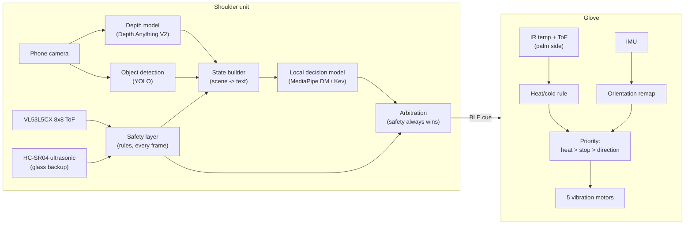
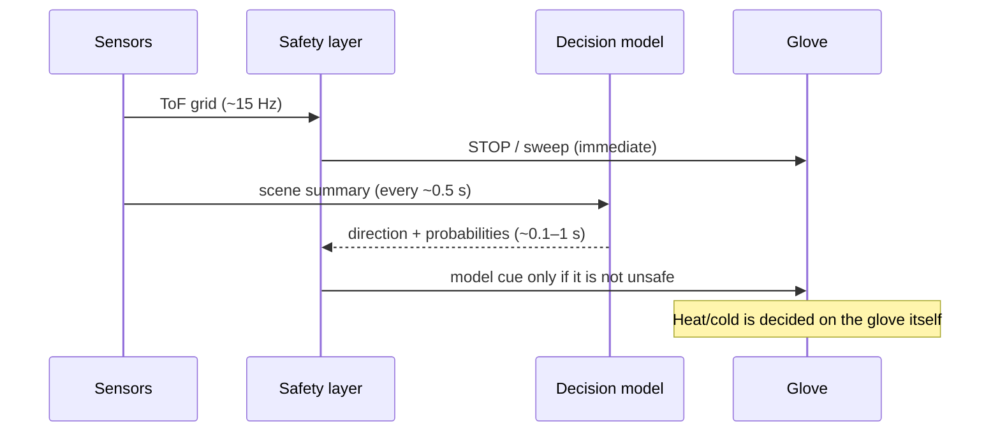
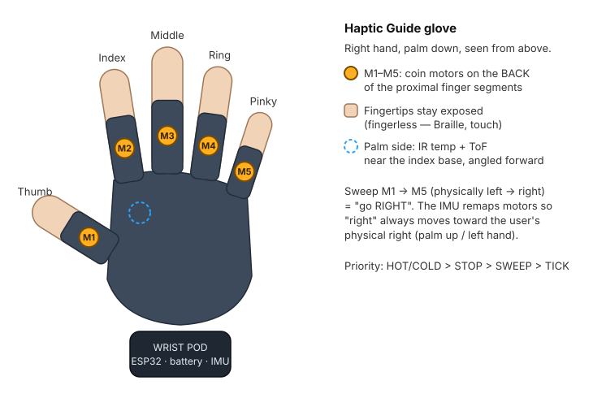

# Haptic Guide — Wearable Assistant for Blind Users

**Project plan, research notes, and software-prototype spec**
Prepared: 10 October 2026 · Status: concept → software validation

> **For the Cowork agent:** Start with [Section 0](#0-cowork-brief--start-here) — it defines the build order, defaults, schemas and acceptance tests. This file is the single source of truth. Use it to (1) produce a polished project document and (2) build the software simulator described in [Section 12](#12-software-prototype-the-haptic-guide-simulator). Facts in [Section 3](#3-the-decision-model-jev-and-local-alternatives) and the prices in [Section 8](#8-hardware-options-and-costs) were researched on 10 Oct 2026 and are linked to sources. Anything marked **VERIFY** has not been confirmed and must be checked before it is presented as fact. Do not change the safety principle in [Section 4](#4-system-architecture).

---

## Table of contents

0. [Cowork brief — start here](#0-cowork-brief--start-here)
1. [Summary](#1-summary)
2. [Users and use case](#2-users-and-use-case)
3. [The decision model: Jev and local alternatives](#3-the-decision-model-jev-and-local-alternatives)
4. [System architecture](#4-system-architecture)
5. [Depth and obstacle sensing](#5-depth-and-obstacle-sensing)
6. [The glove: haptic language](#6-the-glove-haptic-language)
7. [Heat and cold sensing](#7-heat-and-cold-sensing)
8. [Hardware options and costs](#8-hardware-options-and-costs)
9. [Enclosures, materials and ergonomics](#9-enclosures-materials-and-ergonomics)
10. [Avoiding breakage while prototyping](#10-avoiding-breakage-while-prototyping)
11. [Software-first validation plan](#11-software-first-validation-plan)
12. [Software prototype: the Haptic Guide Simulator](#12-software-prototype-the-haptic-guide-simulator)
13. [Go / no-go criteria for the paid build](#13-go--no-go-criteria-for-the-paid-build)
14. [Roadmap](#14-roadmap)
15. [Open questions](#15-open-questions)
16. [References and links](#16-references-and-links)
- [Appendix A — pipeline.py](#appendix-a--pipelinepy)
- [Appendix B — glove_sim.ino (Wokwi firmware)](#appendix-b--glove_simino-wokwi-firmware)

---

## 0. Cowork brief — start here

This section tells an agent starting from zero exactly what to build, in what order, and with which defaults. Where it conflicts with anything later in the document, **this section wins**.

### 0.1 Ground rules

- **Do not invent results.** Any test number not produced by actually running code goes in as a clearly marked placeholder (e.g., `[RESULT: pending Phase 2 test]`).
- **Do not present VERIFY items as fact.**
- **Do not claim medical or clinical effectiveness.** This is an early prototype.
- **Do not change the safety principle** (Section 4.1): the model is never in the safety loop.
- **No paid API calls by default.** Use the mock decision server (0.5). Hosted Jev is only used if the team provides `TYPESAFE_API_KEY`.
- The haptic timings in 0.7 are the **single source of truth**; the simulator and firmware must match them exactly.

### 0.2 Assumptions to confirm with the team before writing the document

| Item | Default used until confirmed |
|---|---|
| Audience | Competition / invention-fair judges and potential sponsors |
| Language | English (Arabic version optional later) |
| Length | ~12–18 pages plus appendices |
| Deadline | **Unknown — ask before starting the document** |
| Team names / roles | Placeholders |

Build the software (0.3 steps 1–5) first; it doesn't depend on these answers.

### 0.3 Build order and definition of done

| Step | Build | Done when |
|---|---|---|
| 1 | **Shared logic + test vectors** (`shared/`) | `test_vectors.json` generated from `pipeline.py`'s `emulate_tof`, `safety_layer` and `arbitrate`; the TypeScript port passes all vectors |
| 2 | **Mock decision server** (0.5) | `pipeline.py --decision-url http://localhost:8000` runs end to end against it |
| 3 | **Simulator Mode B** (interactive world, 0.6) | All acceptance tests in 0.8 pass |
| 4 | **Run recorder** in Mode B | Exports `events.jsonl` (0.4), a WebM of the scene canvas (MediaRecorder), and `labels.csv` from the scenario's ground-truth direction |
| 5 | **Simulator Mode A** (replay) | Replays both a recorder export and a `pipeline.py` output folder in sync |
| 6 | **Project document** | Built from this plan with confirmed answers from 0.2; results tables filled from steps 3–5, placeholders elsewhere |
| 7 | Mode C (Habitat-Sim) | Optional |

The run recorder (step 4) solves the "no real recordings yet" problem: Mode A can be built and tested against synthetic runs before the team records real walks.

### 0.4 `events.jsonl` schema (v1)

One JSON object per processed frame. Written by `pipeline.py` and by the Mode B recorder; read by Mode A.

```json
{
  "schema_version": 1,
  "t": 12.4,
  "timings_ms": {"depth": 85.2, "tof": 0.4, "safety": 0.05, "detect": 22.1, "decision": 148.0},
  "grid_m": [[1.92, 2.05, null, "...8 values"], "...8 rows"],
  "clearance_m": {"left": 2.1, "ahead": 0.85, "right": null},
  "objects": [{"label": "door", "conf": 0.81, "side": "ahead", "dist_m": 3.1}],
  "safety":   {"pattern": "STOP", "intensity": 1.0, "source": "safety"},
  "decision": {"choice": "right", "probabilities": {"forward": 0.1, "left": 0.05, "right": 0.8, "stop": 0.05}, "latency_ms": 148.0},
  "haptic":   {"pattern": "STOP", "intensity": 1.0, "source": "safety"},
  "expected": "stop",
  "ultrasonic_m": 0.9,
  "heat": {"ir_reported_c": 31.5, "true_c": 90.0, "palm_dist_cm": 12.0, "pattern": "NONE"},
  "scenario": "S3_glass_door"
}
```

| Field | Rule |
|---|---|
| `grid_m` | 8×8, row 0 = top; `null` = no target within range |
| `clearance_m` | `null` = clear beyond max range |
| `timings_ms.decision` | `null` on frames where no model call was made |
| `haptic.pattern` | One of `NONE`, `STOP`, `SWEEP_LEFT`, `SWEEP_RIGHT`, `TICK_FORWARD`, `HOT`, `COLD` |
| `expected` | Ground-truth direction or `null` |
| `ultrasonic_m`, `heat`, `scenario` | Mode B only; optional in pipeline output |

### 0.5 Mock decision server

- **Language:** Java 21, single file, no dependencies (`com.sun.net.httpserver`), per the team's preference for Java in glue code. Run: `java MockDecisionServer.java --port 8000`.
- **Endpoint:** `POST /v1/systemone`, same request body as Jev (`model`, `state`, `questions`).
- **Logic:** parse `left X m, ahead Y m, right Z m` from the state text (the format `build_state()` produces; "clear beyond 4 m" = 4.0). If ahead > 2.0 → `forward`; else pick the side with more clearance; if all < 0.9 → `stop`. Turn the four scores into probabilities with a softmax.
- **Stress options:** `--latency-ms 150 --jitter-ms 50 --error-rate 0.05` (a wrong answer 5 % of the time, to prove arbitration catches unsafe ones).
- **Response shape (our assumption — VERIFY against real Jev and adapt only the parser):**

```json
{"answers": {
  "direction":    {"choice": "right", "probabilities": {"forward": 0.1, "left": 0.05, "right": 0.8, "stop": 0.05}},
  "goal_visible": {"value": true, "probability_true": 0.72}
}}
```

### 0.6 Mode B world specification

**Stack:** Vite + React + TypeScript. Canvas 2D for the world and depth views, SVG for the hand (based on `assets/hand-haptic-map.svg`). No backend needed. Vitest for unit tests. The in-browser stub decision model uses the same logic and stress options as the mock server, or calls a real endpoint if a URL is configured.

**Units and avatar**

| Parameter | Default |
|---|---|
| Units | metres, seconds |
| Avatar | circle, radius 0.25 m; keyboard: ↑ walk, ← → turn |
| Walking speed | 1.4 m/s (slider 0.5–1.8) |
| Turn rate | 90°/s |
| Collision | avatar circle touches any obstacle → count + flash |

**Shoulder ToF sensor (2.5D raycast)**

| Parameter | Default |
|---|---|
| Mount height | 1.45 m |
| Field of view | 45° × 45° (VL53L5CX approx. — VERIFY) |
| Tilt | 10° downward |
| Zones | 8 × 8 rays (column = horizontal angle, row = vertical angle) |
| Max range | 4.0 m; **sunlight toggle** cuts it to 1.5 m (placeholder until outdoor test) |
| Noise | Gaussian, 2 % of distance |
| Rate | 15 Hz |
| Floor | Rays that reach the ground return ground distance — this is why `ignore_bottom_rows` exists |
| Glass | **Transparent to ToF** (ray passes through) |

A ray hits an obstacle if the ray's height at that distance falls within the obstacle's `[z_min, z_max]`.

**Ultrasonic sensor:** 30° cone, 0.02–4.0 m, nearest hit, 10 Hz, **detects glass**. In the safety layer: if ultrasonic < `stop_m` → STOP, even if ToF sees clear.

**Scenario file format** (`simulator/scenarios/*.json`):

```json
{
  "name": "S3_glass_door",
  "size_m": [12, 6],
  "start": {"x": 1, "y": 3, "heading_deg": 0},
  "goal":  {"x": 11, "y": 3, "label": "exit"},
  "ambient_c": 25,
  "obstacles": [
    {"type": "rect", "x": 6, "y": 2, "w": 0.05, "h": 2, "z_min": 0, "z_max": 2.1, "material": "glass", "label": "glass door"},
    {"type": "circle", "x": 4, "y": 4.5, "r": 0.3, "z_min": 0, "z_max": 0.45, "material": "furniture", "label": "low stool"},
    {"type": "rect", "x": 8, "y": 1, "w": 0.4, "h": 0.8, "z_min": 1.5, "z_max": 1.9, "material": "furniture", "label": "open cabinet door"},
    {"type": "circle", "x": 3, "y": 1, "r": 0.1, "z_min": 0.9, "z_max": 1.1, "material": "steel_polished", "label": "kettle", "temp_c": 90}
  ],
  "movers": [{"label": "person", "r": 0.3, "path": [[9, 0.5], [9, 5.5]], "speed": 1.0, "z_max": 1.75}]
}
```

**Required scenarios**

| ID | Scene | What it tests |
|---|---|---|
| S1 | Hallway with a door at the end | Basic forward guidance, goal visibility |
| S2 | Office with chairs and tables | Veering left/right, low obstacles |
| S3 | Glass door | ToF misses it, ultrasonic catches it |
| S4 | Head-height overhang (branch / open cabinet) | Shoulder sensor covers what a cane misses |
| S5 | Kitchen counter: polished-steel kettle 90 °C, ceramic mug 70 °C, cold bottle 4 °C | Heat/cold patterns and the shiny-steel misread |
| S6 | Person crossing the path | Moving obstacles, STOP timing |

**Heat model (S5).** In S5 the mouse controls the **hand** position separately from the avatar.

| Parameter | Default |
|---|---|
| Palm IR field of view | 10° (with tube) |
| Spot diameter at distance d | 2·d·tan(5°) |
| Fill factor | min(1, object diameter ÷ spot diameter) |
| Reported temperature | fill · (ε·T_obj + (1−ε)·T_ambient) + (1−fill) · T_ambient |
| Emissivity ε | matte/ceramic 0.95, glass 0.90, polished stainless steel ~0.1–0.2 (VERIFY) |
| Thresholds | HOT ≥ 50 °C, COLD ≤ 5 °C, active within 30 cm |

This reproduces the real limitation: the 90 °C polished kettle reports only a little above ambient and **fails to trigger HOT**. The simulator should show this honestly, with true vs reported temperature side by side.

### 0.7 Haptic timing table (single source of truth)

Matches `firmware/glove_sim.ino`. Duty values are 0–255.

| Pattern | Timing | Strength |
|---|---|---|
| HOT | All 5 on/off every 80 ms | 80 → 255 as palm distance goes 30 → 3 cm |
| COLD | Rolling wave, 1200 ms period, phase offset 0.9 rad per finger (physical left → right) | Same distance mapping |
| STOP | All 5 on 0–300 ms and 450–750 ms, off until 1400 ms, repeat | 255 |
| SWEEP_LEFT / SWEEP_RIGHT | One finger at a time, 90 ms per step, 5 steps then 3 steps (270 ms) pause | 200 (firmware); simulator scales by `intensity` |
| TICK_FORWARD | Middle finger on for 60 ms every 1500 ms | 140 |
| Power on | All 5 on for 400 ms | 255 |

**Priority:** HOT/COLD > STOP > SWEEP > TICK. **Remap:** physical position k → motor = k if (right hand AND palm down) or (left hand AND palm up), else 4 − k. A hub cue older than 1500 ms is dropped.

### 0.8 Simulator acceptance tests

| # | Setup | Expected |
|---|---|---|
| A1 | S1, walk straight with clear path | No STOP; occasional TICK_FORWARD from the model |
| A2 | S2, chair 1.5 m ahead, more room on the right | SWEEP_RIGHT from the safety layer |
| A3 | S3, walk toward the glass door | ToF grid shows clear; ultrasonic triggers STOP before collision |
| A4 | S4, walk under the open cabinet door | STOP from the upper grid rows |
| A5 | S6, person crosses at 1 m | STOP within one sensor frame (~67 ms) of entering stop range |
| A6 | Mock model with `--error-rate 1.0` (always wrong) | Zero collisions caused by the model; every unsafe answer is overridden and logged |
| A7 | Mock model latency 3000 ms | Stale answers ignored after 1.5 s; safety still works |
| A8 | S5, hand approaches the ceramic mug | HOT, strength rising as the hand gets closer |
| A9 | S5, hand approaches the polished kettle | Reported temp shown below threshold; **no HOT** (documented limitation) |
| A10 | Toggle palm up while SWEEP_RIGHT plays | Motor order on the hand reverses; the sweep still moves toward the user's physical right |
| A11 | HOT and STOP at the same time | HOT pattern plays (priority) |
| A12 | Sunlight toggle on in S2 | Detection range drops; collisions/near-misses recorded in metrics |
| A13 | TypeScript safety/arbitration vs Python test vectors | 100 % match |

### 0.9 Target repository layout

```
haptic-guide/
├─ PLAN.md
├─ assets/hand-haptic-map.svg
├─ pipeline/pipeline.py            # Python (ML tooling is Python-first)
├─ mock-server/MockDecisionServer.java
├─ firmware/glove_sim.ino
├─ shared/test_vectors.json
├─ simulator/                      # Vite + React + TypeScript
│  ├─ scenarios/S1..S6.json
│  └─ src/...
├─ data/                           # real recordings + labels (later)
├─ runs/                           # pipeline and recorder outputs
└─ docs/                           # the generated project document
```

---

## 1. Summary

A two-part wearable that helps blind and low-vision people move around and handle objects safely:

- **Shoulder unit** — sees the environment (camera + depth sensing), runs a fast *decision model* locally, and sends simple cues.
- **One glove** — communicates through **vibration on the five fingers** instead of speech, and has its own **heat/cold sensor** that warns the user before they touch something hot or cold, getting stronger as the hand gets closer.

The decision layer is inspired by **Jev**, TypeSafe AI's "System One" decision model, which the team tested and found to deliver what it promises. Because latency matters and the device should work offline, the plan uses **local Jev-style models** (Jev itself cannot run locally — see Section 3).

**Feasibility verdict:** doable. The glove and heat warning are a few weeks of work. Vision-based navigation is the hard part. The plan is to prove the whole pipeline in software first (≈ $0), run two cheap human tests (≈ $15), build a budget prototype (≈ $70–90), and only then pay for the full build.

---

## 2. Users and use case

**Primary users:** blind and low-vision pedestrians, many of whom already use a white cane.

**What the device does**

| Situation | What the user feels | Where it's decided |
|---|---|---|
| Obstacle ahead while walking | STOP pattern, or a sweep telling them which side is clearer | Shoulder unit, safety layer (rules, no AI) |
| Head-height obstacle (branch, open cabinet door) a cane misses | Same as above | Shoulder unit, safety layer |
| "Which way to the door / is the path clear / what is this?" | Directional sweep or a short confirmation | Shoulder unit, decision model |
| Reaching toward something hot (kettle, pot, stove) | Fast pulse on all fingers, stronger as the hand approaches | Glove, local rule |
| Reaching toward something cold | Slow rolling wave on all fingers, stronger as the hand approaches | Glove, local rule |

**Why vibration, not speech:** speech blocks the user's hearing, which blind people rely on heavily (traffic, voices, echoes). Haptics are private, silent, and work in noisy streets.

**Why a heat sensor:** blind people explore the world by touch, so they can't tell whether an object is hot until they've already touched it.

---

## 3. The decision model: Jev and local alternatives

### 3.1 What Jev is

- Jev is a **decision model** from TypeSafe AI, described as a "System One" model: you send a **state** and typed **questions** (`choice`, `noul` = boolean, `score`) and get calibrated probabilities back instead of generated text. ([awesome-typesafe-jev](https://github.com/AbdelStark/awesome-typesafe-jev), [Apache Camel blog](https://camel.apache.org/blog/2026/09/semantic-evaluation-system-one/))
- A widely shared demo claims Jev returns final answers in roughly **70–200 ms** because it doesn't generate text token by token ([source post](https://hermes-ai.net/jev/case/2101000339948282090/)). Treat this as a claim; the team's own tests are the real evidence.
- Hosted endpoint: `POST https://api.typesafe.ai/v1/systemone` with `model`, `state`, and a map of `questions`. Also available through Vercel AI Gateway, Cloudflare Workers AI, OpenRouter and Netlify. ([awesome-jev-typesafe](https://github.com/valentynkit/awesome-jev-typesafe/wiki))

### 3.2 Two hard limits for this project

1. **Jev cannot run locally.** Its weights are not published. ([awesome-jev](https://github.com/kydlikebtc/awesome-jev/wiki))
2. **Jev is text-only.** It accepts text/JSON state, not camera images. ([LiteLLM decisions docs](https://docs.litellm.ai/docs/decisions.md))

So the device needs a **local** decision model, and vision must be turned into text (or the local model must accept images).

### 3.3 Local alternatives

| Option | What it is | Why it matters here | Link |
|---|---|---|---|
| **MediaPipe Decision Maker** (Google) | On-device decision engine with backends: Laya / GLiNER2.5-Decide cross-encoders (~150M), EmbeddingGemma (270–440M), Gemma 4 E2B/E4B | Runs on Android/iOS/Python/Web, **accepts images and audio**, and **parses unmodified Jev JSON payloads** — tested Jev prompts carry over | [Guide](https://developers.google.com/edge/mediapipe/solutions/decision/decision_maker) · [Python](https://developers.google.com/edge/mediapipe/solutions/decision/decision_maker/python) · [Android](https://developers.google.com/edge/mediapipe/solutions/decision/decision_maker/android) · [Live demo](https://google-ai-edge.github.io/mediapipe-samples-web/#/decision/decision_maker) |
| **Kev** | Open Jev-style models (Qwen + LoRA + pointer head, 0.8B–9B) | Implements TypeSafe's `/v1/systemone` contract, so Jev SDK code can point at a local Kev server | [DataCamp overview](https://www.datacamp.com/blog/top-open-source-jev-alternatives) |
| **AWS Strands Decider 2B** | Small local decision model on Qwen3.5-2B with a pointer head | Runs locally; training data and scripts released | [The New Stack](https://thenewstack.io/aws-strands-decider-model/) |
| **JEMM** | Open-weight Jev-like model that also accepts a screenshot/image | Multimodal, self-hosted | [Hugging Face](https://huggingface.co/MaestroYan/JEMM) |
| **LLM2Jev** | Turns local LLMs into Jev-style decision engines, text + images | Lets you try many base models | [GitHub](https://github.com/Yinsongxu/LLM2Jev/wiki) |
| More | Curated lists of Jev tools and replicas | — | [awesome-jev-tools](https://github.com/v-modal/awesome-jev-tools) |

**Reality check on image-based decisions:** one unofficial 4-bit multimodal Jev-style model needed about **1 s and ~7 GB of memory** per image decision on a Mac ([Jev-Omni-MLX-4bit](https://huggingface.co/Ruiruiz30/Jev-Omni-MLX-4bit)). Fine for "what am I holding?", too slow for walking. Hence the architecture below: fast rules for safety, the model for meaning.

**Plan:** use hosted Jev as the **accuracy baseline**, and benchmark MediaPipe Decision Maker and Kev against it on the team's own recorded scenarios.

---

## 4. System architecture

### 4.1 The safety principle (do not change)

> **The AI model is never in the safety loop.** Obstacle STOP warnings and heat/cold warnings come from sensors + simple thresholds running on microcontrollers, responding in well under 100 ms. The decision model only handles slower, semantic questions ("which way is the door?", "is the crossing clear?", "what is this?").

Reason: a person walking at ~1.4 m/s moves about 30 cm during a 200 ms model call plus a camera frame.

### 4.2 Block diagram



### 4.3 Timing



### 4.4 Where the "brain" lives

| Phase | Brain | Why |
|---|---|---|
| Software validation | Laptop | Free, measure everything |
| Budget prototype | **Old Android phone** (or an iPhone Pro for LiDAR) | Already has camera, IMU, compass, GPS, mic, battery, BLE; MediaPipe Decision Maker runs on Android |
| Full build (paid) | Raspberry Pi 5 + OAK-D Lite, or Jetson Orin Nano Super | Dedicated hardware, real depth camera |

---

## 5. Depth and obstacle sensing

Depth is the most important input. Phones have many sensors (camera, IMU, compass, GPS, microphone), but most Androids have **no forward depth sensor** — the "proximity sensor" only detects things a few centimetres away. Phones also can't measure object temperature.

| Option | Cost (approx.) | Strengths | Weaknesses |
|---|---|---|---|
| **VL53L5CX** multizone ToF | ~$15–25 | 8×8 grid of distances up to ~4 m; tells left / centre / right; runs on its own ESP32 so warnings never wait for the phone | Range drops in **strong sunlight** — test outdoors early |
| **HC-SR04** ultrasonic | ~$1 | Sound bounces off **glass doors and windows**, which light-based sensors often see through | Wide beam, imprecise — backup only |
| **Depth Anything V2** on the camera | Free | Depth from a single frame; good scene context | Less reliable for exact distances — context, not safety |
| **iPhone Pro LiDAR** (12 Pro and newer Pro models) | Free if someone owns one | Real depth maps via ARKit | iOS only |
| **ARCore Depth API** on Android | Free | Depth from motion on many Android phones | Needs movement; weak on blank walls (**VERIFY** device support) |
| **OAK-D Lite** (full build) | $169 | Stereo depth + on-camera neural network | Cost, power |

**Recommended prototype setup:** VL53L5CX + HC-SR04 on the shoulder for fast, reliable warnings; phone camera for understanding what obstacles are. Angle the sensors slightly downward to catch low obstacles; the shoulder height also covers head-height obstacles a cane misses.

**Mounting:** the upper arm swings while walking and ruins framing. Use a **collarbone / shoulder-strap mount** (an off-the-shelf action-camera chest or shoulder harness).

Links: [VL53L5CX (ST)](https://www.st.com/en/imaging-and-photonics-solutions/vl53l5cx.html) · [Depth Anything V2](https://github.com/DepthAnything/Depth-Anything-V2) · [ARKit](https://developer.apple.com/documentation/arkit) · [ARCore Depth](https://developers.google.com/ar/develop/depth) · [OAK-D Lite](https://new-store.luxonis.com/products/oak-d-lite-1)

---

## 6. The glove: haptic language

### 6.1 Layout



*Text fallback if the image doesn't render:*

```
        Index  Middle  Ring
          M2     M3     M4    Pinky
   Thumb  ●      ●      ●      M5 ●        ← motors on the BACK of the
     M1 ●                                    proximal finger segments
          [ back of hand ]                  fingertips stay exposed
            ┌───────────┐
            │ WRIST POD │  ESP32 · battery · IMU
            └───────────┘
   Palm side (not shown): IR temp sensor + ToF near index base, angled forward
   Sweep  M1 → M5 (physically left → right) = "go RIGHT"
```

### 6.2 Design decisions

- **One glove** (the team's decision).
- **Fingerless glove.** Blind users read Braille and explore by touch; covered fingertips would take away their main sense. Motors sit on the **back of the fingers**.
- **Direction = sweep, not a single finger.** A quick wave across the fingers reads clearly as a direction and is harder to confuse than "thumb = right".
- **IMU remap.** The glove detects palm-up vs palm-down (and which hand it's on) and remaps motors so "right" always vibrates toward the user's physical right.
- **Electronics in a wrist pod** with detachable JST connectors so the glove can be washed.

### 6.3 Pattern table

| Priority | Event | Pattern | Strength |
|---|---|---|---|
| 1 | **HOT** object near the hand | All 5 motors, fast pulse (~80 ms on/off) | Grows as the hand gets closer |
| 1 | **COLD** object near the hand | Slow rolling wave across all 5 | Grows as the hand gets closer |
| 2 | **STOP** — obstacle ahead | Two long strong all-finger pulses, repeating | Max |
| 3 | **Go LEFT / RIGHT** | Sweep moving physically left / right | Grows as obstacle gets closer (safety) or fixed (model) |
| 4 | **Path clear / forward** (optional) | Short tick on the middle finger | Low |
| — | Power on/off | One long all-finger buzz | — |

Whether HOT should outrank STOP is an open question (Section 15).

### 6.4 Glove parts

| Part | Budget prototype | Better version |
|---|---|---|
| Microcontroller | ESP32-C3 SuperMini (~$3) | [Seeed XIAO ESP32-S3](https://wiki.seeedstudio.com/xiao_esp32s3_getting_started/) (~$8) |
| Motors | 5× ERM coin motors + transistors + flyback diodes (~$5) | 5× LRA + [DRV2605L](https://www.ti.com/product/DRV2605L) drivers (~$45 with TCA9548A mux — the DRV2605L has a fixed I²C address) |
| IMU | MPU6050 (~$2) | BMI270 / LSM6DS3 (~$10) |
| Palm distance | VL53L0X (~$3) | VL53L1X (~$15) |
| Heat | MLX90614 standard + 3D-printed tube (~$10–15) | MLX90614 narrow-FOV variant (~$40–60) |

---

## 7. Heat and cold sensing

- **Sensor:** non-contact IR thermometer **MLX90614**, palm side near the base of the index finger, angled forward. A short 3D-printed tube narrows its field of view cheaply.
- **Distance:** a ToF sensor next to it (VL53L0X / VL53L1X).
- **Logic:** temperature picks the pattern (hot ≥ ~50 °C, cold ≤ ~5 °C — **thresholds to tune**); distance picks the strength (closer = stronger).
- **Optional:** an MLX90640 thermal array (~$60–75) on the shoulder to spot stoves and flames from a distance.

> ⚠️ **Biggest known limitation:** shiny surfaces (stainless-steel pots, kettles) reflect infrared and read far cooler than they are. These are the most common hot objects in a kitchen. Test with real cookware early and document the results honestly. Glass also blocks most of the infrared these sensors read.

---

## 8. Hardware options and costs

Prices checked **10 Oct 2026**; memory shortages have pushed board prices up repeatedly in 2025–26. SAR at 3.75 per USD.

### 8.1 Budget prototype (recommended first build)

| Item | Approx. cost |
|---|---|
| Old Android phone as the brain | $0 (already owned) |
| Phone shoulder/chest harness | ~$10 |
| Glove (budget parts, Section 6.4) | ~$35–50 |
| Depth pod: VL53L5CX + HC-SR04 + ESP32 | ~$20–30 |
| **Total** | **≈ $70–90 (≈ 260–340 SAR)** |

### 8.2 Full build — option A: Raspberry Pi 5 (≈ $440 hub)

| Item | Cost | Source |
|---|---|---|
| Raspberry Pi 5 8GB | $175 | [BGR, Apr 2026](https://www.bgr.com/2150106/raspberry-pi-cost-ram-crisis/) |
| OAK-D Lite (depth + on-camera AI, ~4–4.5 W) | $169 | [Luxonis store](https://new-store.luxonis.com/products/oak-d-lite-1) |
| Power bank, storage, cooler, mount | ~$95 | estimate |

### 8.3 Full build — option B: Jetson Orin Nano Super (≈ $700 hub)

| Item | Cost | Source |
|---|---|---|
| Jetson Orin Nano Super dev kit (price raised from $249) | $399 | [Hardware Busters](https://hwbusters.com/news/nvidia-jetson-prices-jump-up-to-101-the-249-orin-nano-super-is-now-399/) |
| OAK-D Lite (optional) | $169 | above |
| NVMe SSD, USB-C PD power bank + trigger cable, mount | ~$130 | estimate |

### 8.4 Totals (with the better glove, ~$110–160)

| Build | USD | SAR |
|---|---|---|
| Budget prototype | ~$70–90 | ~260–340 |
| Pi build + glove | ~$550–600 | ~2,100–2,250 |
| Jetson build + glove | ~$820–870 | ~3,100–3,300 |

Add a **20–30 % buffer** for local shipping, customs and spares. A custom PCB for the glove (e.g., through a PCB fabrication program) would cut glove electronics to roughly $40–60. Choose the Jetson only if a 2B-class model must look at images directly; otherwise the Pi + OAK-D is enough.

---

## 9. Enclosures, materials and ergonomics

- **Buy the harness, print the pod.** Off-the-shelf action-camera/phone harness + a small 3D-printed sensor pod.
- **Sensor windows:** ToF needs an **open aperture** (ordinary plastic blocks its infrared); ultrasonic transducers must be fully exposed.
- **Material:** **avoid PLA** — it softens around 55–60 °C and a parked car in a Jeddah summer gets hotter. Use **PETG** for rigid parts, **TPU** for straps and bumpers. One 1 kg spool (~$20) covers the prototype.
- **Accessibility:** distinct button shapes findable by touch; a vibration confirms power on/off; **magnetic charging** (lining up USB-C without sight is frustrating); no sharp edges.
- **Batteries:** protected LiPo cells only; don't leave them in a hot car.
- **CAD (free for students):** [Onshape Education](https://www.onshape.com/en/education) · [Fusion personal/education](https://www.autodesk.com/products/fusion-360/personal)

---

## 10. Avoiding breakage while prototyping

- Buy **two of every cheap part**; shipping replacements to Saudi takes weeks.
- Debug firmware in the free **[Wokwi](https://wokwi.com)** ESP32 simulator first (Appendix B).
- Never drive motors from a GPIO pin; use a transistor and a **flyback diode** per motor.
- Double-check **battery polarity** before connecting.
- The expensive parts (phone/Pi/Jetson) are only at risk from bad power wiring; the cheap glove takes the abuse.
- Before buying a Pi or Jetson, ask the university engineering labs whether one can be borrowed.

---

## 11. Software-first validation plan

| # | Test | Tool | Cost | Proves |
|---|---|---|---|---|
| 1 | Record walks with a phone on the shoulder (hallways, doorways, streets, glass doors, outdoor sun) | Phone | $0 | Real test data |
| 2 | Run recordings through the pipeline: depth → ToF emulation → safety → detection → decision | `pipeline.py` (Appendix A) | $0 | Latency per stage, decision accuracy vs hand labels, missed STOPs |
| 3 | Same clips through hosted Jev vs MediaPipe DM vs Kev | `pipeline.py --decision-url` | API credits | How much accuracy local models give up |
| 4 | Tune ToF thresholds on emulated 8×8 grids | `pipeline.py` | $0 | Stop/warn distances before buying the sensor |
| 5 | Thousands of simulated indoor walks | [Habitat-Sim](https://github.com/facebookresearch/habitat-sim) | $0 | Collision and wrong-turn rates (competition evidence) |
| 6 | Glove logic, priorities, IMU remap | Wokwi (Appendix B) | $0 | Firmware correct before hardware |
| 7 | Visual end-to-end demo with the hand | Simulator (Section 12) | $0 | Communicates and stress-tests the whole idea |

**What software cannot prove (needs ~$15 of parts):**

- **Can people tell the vibration patterns apart?** ~$5 of coin motors on a glove + blindfolded volunteers.
- **Heat sensing on real cookware** (the shiny-steel problem). ~$10 MLX90614 + real pots, mugs, kettles.

---

## 12. Software prototype: the Haptic Guide Simulator

### 12.1 Goal

A single application that **simulates the whole pipeline end to end** and shows the result **on a hand with vibrating fingers**, accurately reflecting the use case above. If the simulator plus the two human tests meet the go/no-go criteria (Section 13), the team pays for the full build.

### 12.2 Modes

**Mode A — Replay real recordings.**
Loads a recorded shoulder-camera video and the `events.jsonl` produced by `pipeline.py`, and plays them in sync.

**Mode B — Interactive scenario (runs entirely in the browser, no ML needed).**
A top-down 2D world (hallway, room with furniture, doorway, glass door, street crossing, kitchen counter with a kettle). The user moves an avatar with keyboard/arrow keys. The simulator raycasts from the avatar's shoulder to produce an **8×8 ToF grid** (with configurable noise, max range 4 m, and a "strong sunlight" toggle that cuts range) and an **ultrasonic reading** (wide cone, detects glass). The same safety layer and arbitration logic as `pipeline.py` run on these readings. A "goal" marker drives a stub decision model (or a real Jev-compatible endpoint if configured).

**Mode C — Habitat-Sim (optional, stretch).**
Same as Mode B, but sensor readings come from Habitat-Sim 3D scenes via a small Python bridge.

### 12.3 Screen layout (must-haves)

1. **Scene panel** — video (Mode A) or 2D world (Mode B), with detected objects and a goal marker.
2. **Depth panel** — depth heatmap + the **8×8 ToF grid** with distances in each cell; left / ahead / right clearance bars.
3. **Decision panel** — the state text sent to the model, the chosen option, **probabilities for every option**, latency in ms, and whether arbitration **accepted or overrode** it (and why).
4. **Hand panel (centrepiece)** — the glove drawn like `assets/hand-haptic-map.svg`: five motors on the back of the fingers, wrist pod, palm-side sensor marker. Each motor **animates** (pulse ring / glow / shake) with strength = intensity, following the exact timings in the pattern table (Section 6.3) and the firmware (Appendix B). Show the current pattern name and its priority level.
5. **Glove controls** — right/left hand toggle; palm up/down toggle (shows the IMU remap: a "go right" sweep still moves toward the user's physical right).
6. **Heat module** — sliders for object temperature (−10 to 120 °C) and hand distance (2–60 cm), a **material selector** (matte mug, ceramic, **shiny stainless steel**, glass) that changes the *reported* IR temperature to show the emissivity problem, and the resulting HOT/COLD pattern on the hand.
7. **Metrics panel** — per-stage latency (p50/p95), safety-to-vibration time, decision accuracy vs labels, missed STOP count, collisions (Mode B), heat-detection results.
8. **Timeline** — scrub through the run; markers where STOP fired, where the model was overridden, and where a label disagreed.

### 12.4 Behaviour rules (must match the real device)

- Safety layer runs **every frame**; STOP always wins over the model.
- A model answer older than the TTL (default 1.5 s) is ignored.
- A model "left/right" pointing into a blocked side is overridden by the safety layer.
- On the glove: **HOT/COLD > STOP > LEFT/RIGHT > FORWARD** (priority configurable for experiments).
- Stale hub cues expire on the glove after 1.5 s.
- Thresholds are configurable: stop 0.9 m, warn 2.0 m, hot ≥ 50 °C, cold ≤ 5 °C, heat warning starts within 30 cm.

### 12.5 Accessibility of the simulator itself

- Optional **audio sonification** of each motor (five distinct pitches) so sighted testers can "hear" the patterns, and blind testers can evaluate them.
- Optional **phone vibration output** (Web Vibration API on Android) for a single-motor approximation.
- Keyboard-operable; screen-reader labels on all controls.

### 12.6 Stack and structure

See Section 0.6 (stack) and 0.9 (repository layout); those decisions supersede the notes below.

- Pipeline: Python (`pipeline.py`, Appendix A) → `events.jsonl`, `annotated.mp4`, `report.json`.
- Simulator UI: a single web app (HTML/TypeScript or React) that reads `events.jsonl` for Mode A and runs its own raycast world for Mode B.
- Firmware: `glove_sim.ino` in Wokwi; optionally the simulator can stream cues to it over Web Serial.

```
haptic-guide/
├─ PLAN.md
├─ assets/hand-haptic-map.svg
├─ pipeline/pipeline.py
├─ firmware/glove_sim.ino
├─ data/            # recorded walks + label CSVs (start_s,end_s,expected)
├─ runs/            # pipeline outputs
└─ simulator/       # web app (Modes A, B, C)
```

### 12.7 Deliverables from the Cowork agent

1. A polished project document generated from this plan (keep sources and **VERIFY** flags).
2. The simulator (Modes A and B required, C optional).
3. A short test report template that records the metrics in Section 13.

---

## 13. Go / no-go criteria for the paid build

*Proposed starting thresholds — the team should agree on them before testing.*

| Area | Metric | Target |
|---|---|---|
| Safety | Missed STOP events on labelled obstacle clips | **0** |
| Safety | Safety-layer compute time per frame (laptop, excl. camera) | < 50 ms p95 |
| Decisions | Direction agreement with human labels | ≥ 90 % |
| Decisions | Local decision latency on phone-class hardware | ≤ 500 ms p95 |
| Decisions | Local model vs hosted Jev accuracy gap | ≤ 5 percentage points |
| Haptics | Blindfolded pattern recognition (≥ 5 people, ≥ 40 trials each) | ≥ 95 % |
| Heat | Hot (> 50 °C) matte objects detected at ≥ 10 cm | ≥ 95 % of trials |
| Heat | Shiny steel results | Documented, with a mitigation plan |
| Simulation | Collisions per 100 m in Mode B / Habitat | Team to set after first runs |

---

## 14. Roadmap

| Phase | What | Cost | Exit condition |
|---|---|---|---|
| 0 | Record walks; run `pipeline.py`; benchmark hosted Jev vs local models | $0 + API credits | Latency and accuracy numbers exist |
| 1 | Build the simulator; debug firmware in Wokwi | $0 | Whole pipeline visible on the hand |
| 2 | Two human tests: vibration discrimination + heat on real cookware | ~$15 | Haptic and heat criteria met |
| 3 | Budget prototype: phone + glove + depth pod | ~$70–90 | Works on real walks with a few users |
| ✅ Go/no-go | Section 13 | — | — |
| 4 | Paid build: Pi 5 + OAK-D Lite (or Jetson), custom glove PCB, printed enclosures | ~$550–870 + buffer | Competition-ready device |

---

## 15. Open questions

1. **Which hand gets the glove?** Many blind users hold a cane in their dominant hand, but they also usually reach for things with it — and reaching is where heat sensing matters most. **Ask real users early**; it decides where sensors go.
2. Should **HOT outrank STOP** if both fire at once?
3. How much does **outdoor sunlight** reduce VL53L5CX range in practice?
4. How to handle **shiny cookware** in the heat warning?
5. Which local decision model wins on the team's data: MediaPipe Decision Maker, Kev, or Strands Decider?
6. Are the proposed vibration patterns distinguishable through a glove with motors so close together?

---

## 16. References and links

**Researched 10 Oct 2026**

- Jev overview and ecosystem — <https://github.com/AbdelStark/awesome-typesafe-jev>
- Jev has no published weights — <https://github.com/kydlikebtc/awesome-jev/wiki>
- Jev endpoint and gateways — <https://github.com/valentynkit/awesome-jev-typesafe/wiki>
- Jev/System One is text-only — <https://docs.litellm.ai/docs/decisions.md>
- Jev speed demo (claim) — <https://hermes-ai.net/jev/case/2101000339948282090/>
- Jev in Apache Camel — <https://camel.apache.org/blog/2026/09/semantic-evaluation-system-one/>
- MediaPipe Decision Maker — <https://developers.google.com/edge/mediapipe/solutions/decision/decision_maker>
- Open Jev alternatives (Kev, Rizzo Flow, Von) — <https://www.datacamp.com/blog/top-open-source-jev-alternatives>
- AWS Strands Decider 2B — <https://thenewstack.io/aws-strands-decider-model/>
- JEMM (multimodal, open) — <https://huggingface.co/MaestroYan/JEMM>
- Jev-Omni-MLX-4bit (latency/memory data point) — <https://huggingface.co/Ruiruiz30/Jev-Omni-MLX-4bit>
- LLM2Jev — <https://github.com/Yinsongxu/LLM2Jev/wiki>
- awesome-jev-tools — <https://github.com/v-modal/awesome-jev-tools>
- Jetson price increase to $399 — <https://hwbusters.com/news/nvidia-jetson-prices-jump-up-to-101-the-249-orin-nano-super-is-now-399/>
- Raspberry Pi 5 8GB at $175 — <https://www.bgr.com/2150106/raspberry-pi-cost-ram-crisis/>
- OAK-D Lite — <https://new-store.luxonis.com/products/oak-d-lite-1>

**General references (stable vendor/project pages — spot-check before publishing)**

- Depth Anything V2 — <https://github.com/DepthAnything/Depth-Anything-V2>
- Ultralytics YOLO — <https://docs.ultralytics.com>
- Habitat-Sim — <https://github.com/facebookresearch/habitat-sim>
- Wokwi — <https://wokwi.com>
- VL53L5CX — <https://www.st.com/en/imaging-and-photonics-solutions/vl53l5cx.html>
- DRV2605L — <https://www.ti.com/product/DRV2605L>
- Seeed XIAO ESP32-S3 — <https://wiki.seeedstudio.com/xiao_esp32s3_getting_started/>
- ARKit — <https://developer.apple.com/documentation/arkit> · ARCore Depth — <https://developers.google.com/ar/develop/depth>
- TypeSafe API docs — <https://docs.typesafe.ai>

**Images:** the hand map is in `assets/hand-haptic-map.svg`. Product photos are on the linked vendor pages; if the final document uses them, link or credit the vendor rather than copying images without permission.

---


## Appendix A — pipeline.py

Also saved as `pipeline/pipeline.py`.

```python
#!/usr/bin/env python3
"""
Blind-assist device — software-only pipeline prototype.

    recorded video (phone on shoulder)
      -> metric depth (Depth Anything V2)
      -> emulated 8x8 ToF grid (stands in for a VL53L5CX)
      -> SAFETY LAYER (deterministic rules, never waits for a model)
      -> optional object detection (YOLO)
      -> DECISION MODEL via a Jev-compatible /v1/systemone endpoint
         (hosted Jev as baseline, or a local Jev-style server such as Kev)
      -> arbitration -> haptic pattern for the glove
      -> events.jsonl (replayed by the simulator UI) + latency report

Install:
    pip install opencv-python numpy pillow torch transformers requests
    pip install ultralytics            # optional, for --detector

Examples:
    # safety layer only (no decision model)
    python pipeline.py --video walk.mp4 --out runs/walk1

    # with hosted Jev as the baseline
    export TYPESAFE_API_KEY=...
    python pipeline.py --video walk.mp4 --out runs/walk1_jev \
        --decision-url https://api.typesafe.ai --decision-model jev-1.13.0 \
        --detector yolo11n.pt --goal "reach the door at the end of the hallway"

    # with a local Jev-compatible server (e.g. Kev) on port 8000
    python pipeline.py --video walk.mp4 --out runs/walk1_local \
        --decision-url http://localhost:8000 --decision-model kev

    # score against hand labels (CSV: start_s,end_s,expected  where expected in forward/left/right/stop)
    python pipeline.py --video walk.mp4 --out runs/walk1 --labels walk1_labels.csv

NOTE: The request body follows the public Jev payload shape (state + questions).
The auth header and response field names are marked VERIFY — check them against
https://docs.typesafe.ai before trusting results.
"""
from __future__ import annotations

import argparse
import csv
import json
import os
import time
from dataclasses import dataclass, asdict

import cv2
import numpy as np
from PIL import Image

# ----------------------------------------------------------------------------- config

DIRECTIONS = ["forward", "left", "right", "stop"]

QUESTIONS = {
    "direction": {
        "type": "choice",
        "instructions": (
            "You guide a blind pedestrian. Choose the safest next movement that also "
            "makes progress toward the user's goal, using only the supplied state."
        ),
        "criteria": {
            "forward": "The path straight ahead is clear enough to keep walking.",
            "left": "The user should veer or turn left.",
            "right": "The user should veer or turn right.",
            "stop": "The user should stop because continuing is unsafe or unclear.",
        },
    },
    "goal_visible": {
        "type": "noul",
        "condition": "The thing the user is trying to reach is visible in the scene.",
        "threshold": 0.5,
    },
}


@dataclass
class Haptic:
    pattern: str          # NONE | STOP | SWEEP_LEFT | SWEEP_RIGHT | TICK_FORWARD
    intensity: float      # 0..1
    source: str           # safety | decision | none


# ----------------------------------------------------------------------------- depth

def load_depth(model_id: str, device: str):
    from transformers import pipeline
    return pipeline("depth-estimation", model=model_id, device=device)


def depth_map_m(depth_pipe, frame_bgr) -> np.ndarray:
    """Return a metric depth map in metres (requires a *Metric* Depth Anything V2 model)."""
    rgb = cv2.cvtColor(frame_bgr, cv2.COLOR_BGR2RGB)
    out = depth_pipe(Image.fromarray(rgb))
    d = out["predicted_depth"]
    if hasattr(d, "detach"):
        d = d.squeeze().detach().cpu().numpy()
    return np.asarray(d, dtype=np.float32)


# ----------------------------------------------------------------------------- ToF emulation

def emulate_tof(depth_m: np.ndarray, zones: int = 8, fov_frac: float = 0.6,
                max_range: float = 4.0, noise: float = 0.02,
                rng: np.random.Generator | None = None) -> np.ndarray:
    """Shrink a depth map to a zones x zones grid like a multizone ToF sensor.

    fov_frac: the phone camera is wider than the VL53L5CX (~63 deg diagonal, check
    datasheet), so only the central part of the frame is used.
    Each zone reports a near percentile (closest dominant target), plus noise.
    Zones beyond max_range report inf (no target), as the real sensor would.
    """
    h, w = depth_m.shape
    ch, cw = int(h * fov_frac), int(w * fov_frac)
    y0, x0 = (h - ch) // 2, (w - cw) // 2
    crop = depth_m[y0:y0 + ch, x0:x0 + cw]
    zh, zw = ch // zones, cw // zones
    grid = np.empty((zones, zones), np.float32)
    for i in range(zones):
        for j in range(zones):
            cell = crop[i * zh:(i + 1) * zh, j * zw:(j + 1) * zw]
            grid[i, j] = np.percentile(cell, 10)
    if rng is not None and noise > 0:
        grid = grid + rng.normal(0.0, noise, grid.shape).astype(np.float32) * grid
    grid[grid > max_range] = np.inf
    return grid


# ----------------------------------------------------------------------------- safety layer

def safety_layer(grid: np.ndarray, stop_m: float, warn_m: float, ignore_bottom_rows: int):
    """Deterministic obstacle rules. Runs every frame; never waits on a model.

    ignore_bottom_rows: a downward-angled shoulder sensor sees the floor in its
    bottom rows; exclude them so the floor is not treated as an obstacle.
    """
    rows = grid[: grid.shape[0] - ignore_bottom_rows] if ignore_bottom_rows else grid
    finite = np.where(np.isfinite(rows), rows, 99.0)
    n = finite.shape[1]
    third = max(1, n // 3)
    left = float(finite[:, :third].min())
    ahead = float(finite[:, third:n - third].min())
    right = float(finite[:, n - third:].min())
    clearance = {"left": left, "ahead": ahead, "right": right}

    def strength(d):
        return float(np.clip((warn_m - d) / max(warn_m - stop_m, 1e-6), 0.2, 1.0))

    if ahead < stop_m:
        return Haptic("STOP", 1.0, "safety"), clearance
    if ahead < warn_m:
        side = "SWEEP_LEFT" if left > right else "SWEEP_RIGHT"
        return Haptic(side, strength(ahead), "safety"), clearance
    return Haptic("NONE", 0.0, "none"), clearance


# ----------------------------------------------------------------------------- detection

def load_detector(weights: str | None):
    if not weights:
        return None
    try:
        from ultralytics import YOLO
    except ImportError:
        print("[warn] ultralytics not installed; continuing without detection")
        return None
    return YOLO(weights)


def detect(detector, frame_bgr, depth_m, max_objs: int = 8):
    if detector is None:
        return []
    res = detector(frame_bgr, verbose=False)[0]
    fh, fw = frame_bgr.shape[:2]
    dh, dw = depth_m.shape
    objs = []
    for b in res.boxes:
        x1, y1, x2, y2 = b.xyxy[0].tolist()
        cx, cy = (x1 + x2) / 2, (y1 + y2) / 2
        dx, dy = int(cx / fw * (dw - 1)), int(cy / fh * (dh - 1))
        dist = float(depth_m[dy, dx])
        side = "left" if cx < fw / 3 else "right" if cx > 2 * fw / 3 else "ahead"
        objs.append({"label": res.names[int(b.cls)], "conf": round(float(b.conf), 2),
                     "side": side, "dist_m": round(dist, 2)})
    objs.sort(key=lambda o: o["dist_m"])
    return objs[:max_objs]


# ----------------------------------------------------------------------------- decision model

def build_state(goal: str, clearance: dict, objs: list) -> str:
    def fmt(d):
        return "clear beyond 4 m" if d >= 99 else f"{d:.1f} m"
    lines = [
        f"User goal: {goal}.",
        f"Free space measured by the shoulder sensor: left {fmt(clearance['left'])}, "
        f"ahead {fmt(clearance['ahead'])}, right {fmt(clearance['right'])}.",
    ]
    if objs:
        lines.append("Objects seen: " + "; ".join(
            f"{o['label']} {o['side']} at about {o['dist_m']:.1f} m" for o in objs) + ".")
    else:
        lines.append("No objects detected.")
    return "\n".join(lines)


class DecisionClient:
    """Talks to any Jev-compatible POST {base}/v1/systemone endpoint."""

    def __init__(self, base_url: str, model: str, api_key: str | None, timeout: float):
        import requests
        self.requests = requests
        self.url = base_url.rstrip("/") + "/v1/systemone"
        self.model = model
        self.api_key = api_key
        self.timeout = timeout

    def decide(self, state: str):
        body = {"model": self.model, "state": state, "questions": QUESTIONS}
        headers = {"Content-Type": "application/json"}
        if self.api_key:
            headers["Authorization"] = f"Bearer {self.api_key}"  # VERIFY auth scheme
        t0 = time.perf_counter()
        r = self.requests.post(self.url, json=body, headers=headers, timeout=self.timeout)
        ms = (time.perf_counter() - t0) * 1000
        r.raise_for_status()
        return r.json(), ms


def extract_choice(resp: dict, key: str) -> tuple[str | None, dict]:
    """Defensively pull the winning option + probabilities. VERIFY field names."""
    node = None
    for container in ("answers", "results", "decisions", "outputs"):
        if isinstance(resp.get(container), dict) and key in resp[container]:
            node = resp[container][key]
            break
    if node is None and isinstance(resp.get(key), dict):
        node = resp[key]
    if not isinstance(node, dict):
        return None, {}
    probs = node.get("probabilities") or node.get("probs") or {}
    for k in ("choice", "selected", "selected_key", "answer", "value"):
        if isinstance(node.get(k), str):
            return node[k], probs
    if probs:
        return max(probs, key=probs.get), probs
    return None, probs


def arbitrate(safety: Haptic, decision: str | None, clearance: dict, stop_m: float) -> Haptic:
    """Safety always wins. A model decision is only used when it is not unsafe."""
    if safety.pattern == "STOP":
        return safety
    if decision is None:
        return safety
    if decision == "stop":
        return Haptic("STOP", 0.8, "decision")
    if decision in ("left", "right") and clearance[decision] < stop_m:
        return safety  # model points into a blocked side -> ignore it
    if decision == "left":
        return Haptic("SWEEP_LEFT", 0.6, "decision")
    if decision == "right":
        return Haptic("SWEEP_RIGHT", 0.6, "decision")
    if safety.pattern != "NONE":
        return safety
    return Haptic("TICK_FORWARD", 0.3, "decision")


# ----------------------------------------------------------------------------- labels / scoring

def load_labels(path: str | None):
    if not path:
        return []
    with open(path, newline="") as f:
        return [(float(r["start_s"]), float(r["end_s"]), r["expected"].strip().lower())
                for r in csv.DictReader(f)]


def label_at(labels, t: float):
    for s, e, exp in labels:
        if s <= t <= e:
            return exp
    return None


def pattern_to_direction(p: str) -> str:
    return {"STOP": "stop", "SWEEP_LEFT": "left", "SWEEP_RIGHT": "right"}.get(p, "forward")


# ----------------------------------------------------------------------------- overlay

def draw_overlay(frame, grid, haptic: Haptic, decision, dec_ms):
    out = frame.copy()
    h, w = out.shape[:2]
    cell = max(10, min(w, h) // 30)
    for i in range(grid.shape[0]):
        for j in range(grid.shape[1]):
            d = grid[i, j]
            v = 0 if not np.isfinite(d) else int(np.clip(255 * (1 - d / 4.0), 0, 255))
            cv2.rectangle(out, (10 + j * cell, 10 + i * cell),
                          (10 + (j + 1) * cell - 1, 10 + (i + 1) * cell - 1), (0, 0, v), -1)
    txt = f"{haptic.pattern} {haptic.intensity:.2f} [{haptic.source}]"
    cv2.putText(out, txt, (10, h - 40), cv2.FONT_HERSHEY_SIMPLEX, 0.8, (0, 255, 255), 2)
    if decision:
        cv2.putText(out, f"model: {decision} ({dec_ms:.0f} ms)", (10, h - 12),
                    cv2.FONT_HERSHEY_SIMPLEX, 0.7, (255, 255, 0), 2)
    return out


# ----------------------------------------------------------------------------- main

def pct(xs, p):
    return float(np.percentile(xs, p)) if xs else float("nan")


def main():
    ap = argparse.ArgumentParser(description=__doc__, formatter_class=argparse.RawDescriptionHelpFormatter)
    ap.add_argument("--video", required=True)
    ap.add_argument("--out", required=True)
    ap.add_argument("--goal", default="walk forward safely")
    ap.add_argument("--depth-model", default="depth-anything/Depth-Anything-V2-Metric-Indoor-Small-hf",
                    help="use ...-Metric-Outdoor-Small-hf for outdoor clips")
    ap.add_argument("--device", default="cpu", help="cpu, cuda, or mps")
    ap.add_argument("--fps", type=float, default=10.0, help="frames per second to process")
    ap.add_argument("--stop-m", type=float, default=0.9)
    ap.add_argument("--warn-m", type=float, default=2.0)
    ap.add_argument("--ignore-bottom-rows", type=int, default=2)
    ap.add_argument("--detector", default=None, help="e.g. yolo11n.pt (needs ultralytics)")
    ap.add_argument("--decision-url", default=None, help="base URL of a Jev-compatible server")
    ap.add_argument("--decision-model", default="jev-1.13.0")
    ap.add_argument("--decide-every-ms", type=float, default=500.0)
    ap.add_argument("--decision-ttl-ms", type=float, default=1500.0,
                    help="ignore a model answer older than this")
    ap.add_argument("--labels", default=None)
    ap.add_argument("--no-video-out", action="store_true")
    args = ap.parse_args()

    os.makedirs(args.out, exist_ok=True)
    rng = np.random.default_rng(0)
    depth_pipe = load_depth(args.depth_model, args.device)
    detector = load_detector(args.detector)
    client = None
    if args.decision_url:
        client = DecisionClient(args.decision_url, args.decision_model,
                                os.environ.get("TYPESAFE_API_KEY"), timeout=5.0)
    labels = load_labels(args.labels)

    cap = cv2.VideoCapture(args.video)
    src_fps = cap.get(cv2.CAP_PROP_FPS) or 30.0
    step = max(1, int(round(src_fps / args.fps)))
    writer = None

    stage_ms = {"depth": [], "tof": [], "safety": [], "detect": [], "decision": [], "total_local": []}
    last_dec, last_dec_t, last_dec_ms = None, -1e9, 0.0
    agree = total_labeled = missed_stops = 0

    events_path = os.path.join(args.out, "events.jsonl")
    with open(events_path, "w") as ev:
        idx = 0
        while True:
            ok, frame = cap.read()
            if not ok:
                break
            if idx % step:
                idx += 1
                continue
            t_video = idx / src_fps
            idx += 1

            t0 = time.perf_counter()
            depth = depth_map_m(depth_pipe, frame)
            t1 = time.perf_counter()
            grid = emulate_tof(depth, rng=rng)
            t2 = time.perf_counter()
            safety, clearance = safety_layer(grid, args.stop_m, args.warn_m, args.ignore_bottom_rows)
            t3 = time.perf_counter()
            objs = detect(detector, frame, depth)
            t4 = time.perf_counter()

            stage_ms["depth"].append((t1 - t0) * 1000)
            stage_ms["tof"].append((t2 - t1) * 1000)
            stage_ms["safety"].append((t3 - t2) * 1000)
            stage_ms["detect"].append((t4 - t3) * 1000)
            stage_ms["total_local"].append((t3 - t0) * 1000)

            raw_resp, probs = None, {}
            now_ms = t_video * 1000
            if client and now_ms - last_dec_t >= args.decide_every_ms:
                state = build_state(args.goal, clearance, objs)
                try:
                    raw_resp, last_dec_ms = client.decide(state)
                    last_dec, probs = extract_choice(raw_resp, "direction")
                    last_dec_t = now_ms
                    stage_ms["decision"].append(last_dec_ms)
                except Exception as e:  # network / server errors must never block safety
                    print(f"[warn] decision call failed: {e}")
            fresh = last_dec if (now_ms - last_dec_t) <= args.decision_ttl_ms else None
            final = arbitrate(safety, fresh, clearance, args.stop_m)

            expected = label_at(labels, t_video)
            if expected:
                total_labeled += 1
                got = pattern_to_direction(final.pattern)
                agree += int(got == expected)
                missed_stops += int(expected == "stop" and got != "stop")

            ev.write(json.dumps({
                "schema_version": 1,
                "t": round(t_video, 3),
                "timings_ms": {
                    "depth": round((t1 - t0) * 1000, 1),
                    "tof": round((t2 - t1) * 1000, 2),
                    "safety": round((t3 - t2) * 1000, 2),
                    "detect": round((t4 - t3) * 1000, 1),
                    "decision": round(last_dec_ms, 1) if raw_resp is not None else None,
                },
                "grid_m": [[None if not np.isfinite(v) else round(float(v), 2) for v in row] for row in grid],
                "clearance_m": {k: (None if v >= 99 else round(v, 2)) for k, v in clearance.items()},
                "objects": objs,
                "safety": asdict(safety),
                "decision": {"choice": fresh, "probabilities": probs, "latency_ms": round(last_dec_ms, 1)},
                "haptic": asdict(final),
                "expected": expected,
            }) + "\n")

            if not args.no_video_out:
                vis = draw_overlay(frame, grid, final, fresh, last_dec_ms)
                if writer is None:
                    h, w = vis.shape[:2]
                    writer = cv2.VideoWriter(os.path.join(args.out, "annotated.mp4"),
                                             cv2.VideoWriter_fourcc(*"mp4v"), args.fps, (w, h))
                writer.write(vis)

    cap.release()
    if writer:
        writer.release()

    report = {k: {"p50": round(pct(v, 50), 1), "p95": round(pct(v, 95), 1), "n": len(v)}
              for k, v in stage_ms.items()}
    if total_labeled:
        report["accuracy_vs_labels"] = round(agree / total_labeled, 3)
        report["missed_stops"] = missed_stops
        report["labeled_frames"] = total_labeled
    with open(os.path.join(args.out, "report.json"), "w") as f:
        json.dump(report, f, indent=2)
    print(json.dumps(report, indent=2))
    print(f"events -> {events_path}")


if __name__ == "__main__":
    main()
```

## Appendix B — glove_sim.ino (Wokwi firmware)

Also saved as `firmware/glove_sim.ino`.

```cpp
/*
  Blind-assist glove — firmware logic for the Wokwi ESP32 simulator.
  https://wokwi.com  (create a new ESP32 Arduino project and paste this in)

  Stand-ins used in simulation:
    5 LEDs (+220 ohm)  -> the 5 vibration motors (brightness = vibration strength)
    Potentiometer A    -> IR object temperature   (maps to -10 .. 120 C)
    Potentiometer B    -> palm-side ToF distance  (maps to 2 .. 60 cm)
    Push button        -> IMU "palm up / palm down" flip
    Serial Monitor     -> cues from the shoulder hub (type l, r, s, f, x)

  Wiring:
    LEDs (thumb..pinky): GPIO 4, 5, 18, 19, 21 -> resistor -> GND
    Pot A wiper: GPIO 34   Pot B wiper: GPIO 35  (pot ends to 3V3 and GND)
    Button: GPIO 23 to GND (internal pull-up)

  On real hardware: swap LEDs for motor transistors + flyback diodes,
  potentiometers for MLX90614 / VL53L0X readings, button for the IMU.

  Priority: HEAT/COLD (local, imminent contact) > STOP > LEFT/RIGHT > FORWARD tick.
*/

const bool RIGHT_HAND = true;                 // set per user (open question: which hand?)
const int  MOTOR[5]   = {4, 5, 18, 19, 21};   // thumb, index, middle, ring, pinky
const int  POT_TEMP = 34, POT_DIST = 35, BTN_FLIP = 23;

const float HOT_C   = 50.0;   // tune with real cookware
const float COLD_C  = 5.0;
const float WARN_CM = 30.0;   // start warning within this distance
const float MIN_CM  = 3.0;
const int   MIN_DUTY = 80;    // weakest perceptible vibration (tune on real motors)

enum Cue { CUE_NONE, CUE_LEFT, CUE_RIGHT, CUE_STOP, CUE_FORWARD };
Cue hubCue = CUE_NONE;
unsigned long cueStart = 0;
const unsigned long CUE_TIMEOUT_MS = 1500;    // a stale hub cue is dropped

bool palmDown = true;
unsigned long lastBtn = 0;

void setOne(int motor, int duty) { analogWrite(MOTOR[motor], duty); }
void setAll(int duty) { for (int i = 0; i < 5; i++) setOne(i, duty); }

// Motor index at physical position k (0 = user's leftmost finger, 4 = rightmost).
int physicalToMotor(int k) {
  bool thumbOnLeft = (RIGHT_HAND == palmDown);
  return thumbOnLeft ? k : 4 - k;
}

int dutyFromDistance(float cm) {
  float s = (WARN_CM - cm) / (WARN_CM - MIN_CM);
  s = constrain(s, 0.0, 1.0);
  return MIN_DUTY + (int)(s * (255 - MIN_DUTY));
}

void patternHot(unsigned long t, int duty) {            // fast pulse, all fingers
  setAll(((t / 80) % 2 == 0) ? duty : 0);
}

void patternCold(unsigned long t, int duty) {           // slow rolling wave
  for (int k = 0; k < 5; k++) {
    float phase = (t % 1200) / 1200.0 * 2 * PI - k * 0.9;
    float v = (sin(phase) + 1) / 2;
    setOne(physicalToMotor(k), (int)(v * duty));
  }
}

void patternStop(unsigned long t) {                     // two long pulses, then a gap
  unsigned long p = t % 1400;
  bool on = (p < 300) || (p >= 450 && p < 750);
  setAll(on ? 255 : 0);
}

void patternSweep(unsigned long t, bool towardRight, int duty) {
  int step = (t / 90) % 8;                              // 5 steps + 3 steps pause
  setAll(0);
  if (step < 5) {
    int k = towardRight ? step : 4 - step;
    setOne(physicalToMotor(k), duty);
  }
}

void patternForward(unsigned long t) {                  // short tick on the middle finger
  setAll(0);
  if (t % 1500 < 60) setOne(2, 140);
}

void readSerial() {
  while (Serial.available()) {
    char c = tolower(Serial.read());
    Cue next = hubCue;
    if (c == 'l') next = CUE_LEFT;
    else if (c == 'r') next = CUE_RIGHT;
    else if (c == 's') next = CUE_STOP;
    else if (c == 'f') next = CUE_FORWARD;
    else if (c == 'x') next = CUE_NONE;
    else continue;
    hubCue = next;
    cueStart = millis();
    Serial.printf("hub cue -> %c\n", c);
  }
}

void setup() {
  Serial.begin(115200);
  for (int i = 0; i < 5; i++) pinMode(MOTOR[i], OUTPUT);
  pinMode(BTN_FLIP, INPUT_PULLUP);
  Serial.println("Glove sim ready. Type l / r / s / f / x. Button flips palm orientation.");
  setAll(255); delay(400); setAll(0);                   // power-on confirmation buzz
}

void loop() {
  unsigned long t = millis();
  readSerial();

  if (digitalRead(BTN_FLIP) == LOW && t - lastBtn > 300) {
    palmDown = !palmDown;
    lastBtn = t;
    Serial.printf("palm %s\n", palmDown ? "DOWN" : "UP");
  }

  float tempC = map(analogRead(POT_TEMP), 0, 4095, -100, 1200) / 10.0;
  float distCm = map(analogRead(POT_DIST), 0, 4095, 20, 600) / 10.0;
  bool near = distCm < WARN_CM;

  if (hubCue != CUE_NONE && t - cueStart > CUE_TIMEOUT_MS) hubCue = CUE_NONE;

  if (near && tempC >= HOT_C)       patternHot(t, dutyFromDistance(distCm));
  else if (near && tempC <= COLD_C) patternCold(t, dutyFromDistance(distCm));
  else if (hubCue == CUE_STOP)      patternStop(t);
  else if (hubCue == CUE_LEFT)      patternSweep(t, false, 200);
  else if (hubCue == CUE_RIGHT)     patternSweep(t, true, 200);
  else if (hubCue == CUE_FORWARD)   patternForward(t);
  else                              setAll(0);

  delay(10);
}
```
